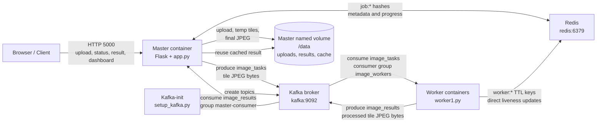
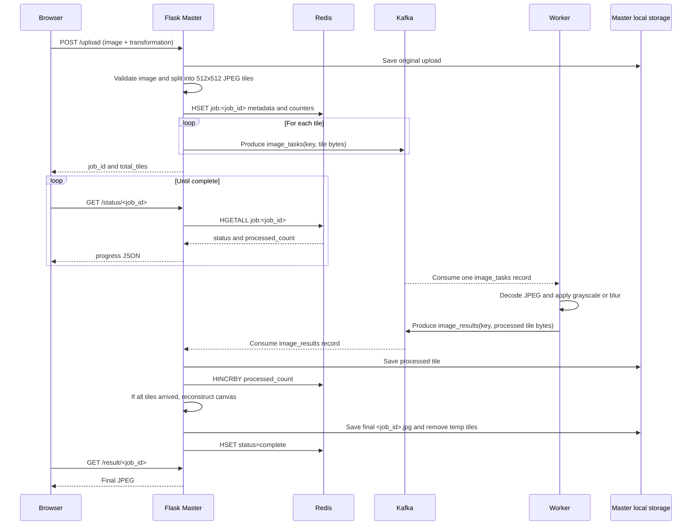
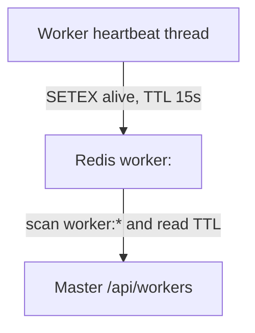

# Distributed Image Processing System Architecture

This document describes the architecture that is implemented in this repository,
including how the services communicate during startup, image processing, result
collection, and worker monitoring.

## 1. Architectural summary

The system uses a master-worker architecture:

- **The browser/client** communicates with the Flask master over HTTP.
- **The master** validates uploads, splits images into tiles, publishes work, tracks
  job metadata, consumes processed tiles, and reconstructs the final image.
- **Kafka** is the asynchronous transport for image tasks and processed tile
  results.
- **Redis** is the shared state store for job metadata, progress counters, and
  worker liveness keys.
- **The master cache** stores completed results by image content and
  transformation so repeated requests can skip processing.
- **Workers** consume tile tasks from Kafka, apply a transformation with OpenCV,
  publish the processed tile, and periodically refresh their own liveness keys
  directly in Redis.
- **Local storage** is used only by the master for uploaded files, temporary
  processed tiles, and final results.

The workers do not communicate directly with the browser or the master over HTTP.
Kafka and Redis are the communication boundaries between the processing services.

## 2. Runtime architecture



### Communication boundaries

| From | To | Protocol / interface | Purpose |
|---|---|---|---|
| Browser | Master | HTTP | Upload image, poll status, download result, view dashboard |
| Master | Kafka | Kafka producer | Publish one task per image tile |
| Workers | Kafka | Kafka consumer/producer | Consume tasks and publish processed tiles |
| Master | Kafka | Kafka consumer | Consume processed tile results |
| Master | Redis | Redis commands | Store job metadata and atomically increment progress |
| Workers | Redis | Redis `SETEX` | Refresh short-lived liveness keys |
| Master | Local storage | Filesystem | Persist uploaded images, temporary tiles, and results |

## 3. Docker Compose topology

The Compose deployment creates these services:

| Service | Implementation | Network identity | Role |
|---|---|---|---|
| `kafka` | `apache/kafka:3.9.0` | `kafka:9092` | Single Kafka broker/controller |
| `kafka-init` | `setup_kafka.py` | `kafka:9092` | Creates required topics, then exits |
| `redis` | `redis:7-alpine` | `redis:6379` | Shared state and liveness store |
| `master` | `app.py` | `0.0.0.0:5000` | HTTP API and orchestration |
| `worker` | `worker1.py` | Kafka/Redis clients | Tile processing; horizontally scalable |

Only the master publishes port `5000` to the host. Kafka and Redis stay on the
internal Compose network. The `master-data` named volume is mounted at `/data`
in the master, so uploads, temporary tiles, and final results survive a master
container restart while the volume exists.

Startup ordering is:

1. Kafka becomes healthy.
2. `kafka-init` creates `image_tasks` and `image_results`. Worker liveness
   heartbeats use Redis directly and do not require a Kafka topic.
3. Redis becomes healthy.
4. Master and workers start after their dependencies are ready.

The applications also retry Redis connections while Kafka/Redis are starting.

## 4. Kafka topics and message contracts

### `image_tasks`

Created with **2 partitions** and consumed by all workers in the
`image_workers` consumer group. Kafka assigns each task to one worker in the
group, allowing tiles to be processed in parallel.

- **Key:** `job_id:tile_id:transformation`
- **Value:** JPEG-encoded tile bytes
- **Example key:** `550e8400-e29b-41d4-a716-446655440000:3:blur`

The master creates one message for each tile. The tile position is not encoded in
the Kafka message because the master reconstructs positions from the numeric
`tile_id` and the original image dimensions stored in Redis.

### `image_results`

Created with **1 partition** and consumed by the master in the
`master-consumer` group.

- **Key:** `job_id:tile_id`
- **Value:** JPEG-encoded processed tile bytes

The master writes each received value to the job’s temporary tile directory,
increments `processed_count` in Redis with `HINCRBY`, and reconstructs the result
when the count reaches `total_tiles`.

Worker liveness is not a Kafka message contract. Each worker refreshes its own
`worker:<worker_id>` Redis key with `SETEX` every five seconds. The key expires
after 15 seconds if the worker stops.

## 5. End-to-end image-processing flow



### Detailed processing stages

1. `POST /upload` accepts an image and either `grayscale` or `blur`.
2. The master generates a UUID job ID and saves the original file under
   `uploads/<job_id>_<filename>`.
3. OpenCV reads the image. Images must be at least `1024 x 1024`; tiles are
   normally `512 x 512`, with smaller edge tiles when dimensions are not exact
   multiples of 512.
4. The master stores this Redis hash:

   ```text
   job:<job_id>
     status=processing|complete|error
     transformation=grayscale|blur
     total_tiles=<number>
     processed_count=<number>
     img_width=<pixels>
     img_height=<pixels>
     filename=<original filename>
   ```

5. The master publishes tile JPEG bytes to `image_tasks`.
6. A worker consumes the task, decodes the JPEG, applies the selected
   transformation, re-encodes it as JPEG, and publishes it to `image_results`.
7. The master consumes the result, writes it to
   `temp_tiles/<job_id>/tile_<tile_id>.jpg`, and atomically increments
   `processed_count`.
8. Once all results are present, the master calculates each tile’s row and
   column from `tile_id`, places the tiles on a full-size canvas, writes
   `results/<job_id>.jpg`, marks the job complete, and removes temporary tiles.
9. The browser polls `/status/<job_id>` and then downloads `/result/<job_id>`.

## 6. HTTP API communication

| Method | Endpoint | Client | Behavior |
|---|---|---|---|
| `GET` | `/` | Browser | Serves the upload page |
| `POST` | `/upload` | Browser | Starts a job; returns `job_id` and `total_tiles` |
| `GET` | `/status/<job_id>` | Browser | Reads job progress from Redis |
| `GET` | `/result/<job_id>` | Browser | Streams the final JPEG from master storage |
| `GET` | `/dashboard` | Browser | Serves the worker dashboard |
| `GET` | `/api/workers` | Dashboard JavaScript | Reads active worker TTLs from Redis |
| `GET` | `/health` | Docker / operator | Pings Redis and checks Kafka metadata |

The upload page polls `/status/<job_id>` every second while processing.
The dashboard polls `/api/workers` every three seconds.

## 7. Worker liveness flow



Every worker sends a heartbeat every **5 seconds** and the liveness key expires
after **15 seconds**. Therefore, a worker that stops sending heartbeats is
removed from the active list once its Redis key expires. The Flask API supplies
the dashboard data directly from Redis.

## 8. Scaling and delivery characteristics

- Run additional replicas of the `worker` service to increase task-processing
  concurrency:

  ```bash
  docker compose up -d --scale worker=4
  ```

- The `image_workers` consumer group ensures a task is assigned to one worker
  instance, rather than every worker processing the same task.
- The current task topic has two partitions, so it limits simultaneous Kafka
  task consumption to two active consumers unless the topic is recreated with
  more partitions.
- The result topic has one partition, so result messages are serialized through
  one Kafka partition before the master consumes them.
- Kafka and Redis are configured as single-instance services with replication
  factor `1` in Compose. This deployment is therefore process/container
  fault-tolerant, but not a highly available multi-broker or replicated-data
  deployment.
- Kafka consumers use auto-commit. The application does not implement an
  application-level retry or deduplication protocol for failed tile processing.
- Results and temporary tiles are stored on the master’s local volume; workers
  do not need a shared filesystem.

## 9. Source map

| Concern | Source |
|---|---|
| Flask routes, tiling, task publishing, result consumption, reconstruction | [`app.py`](./app.py) |
| Shared configuration, topic names, Redis key helpers | [`config.py`](./config.py) |
| Worker task consumption, transformations, results, heartbeats | [`worker1.py`](./worker1.py) |
| Alternate worker entry point with the same processing flow | [`worker2.py`](./worker2.py) |
| Worker liveness updates | [`worker1.py`](./worker1.py) and [`worker2.py`](./worker2.py) |
| Master filesystem boundary | [`storage.py`](./storage.py) |
| Topic creation and partition counts | [`setup_kafka.py`](./setup_kafka.py) |
| Container services, health checks, dependencies, and volume | [`docker-compose.yml`](./docker-compose.yml) |

## 10. Direct answers to the implementation questions

### Who creates the job ID?

The Flask master creates it inside the `POST /upload` route in `app.py`:

```python
job_id = str(uuid.uuid4())
```

`uuid.uuid4()` creates a random UUID. The job ID is created before the upload is
saved and before the image is split. It is then used consistently as:

- the prefix in the uploaded filename;
- the Redis metadata key, `job:<job_id>`;
- the prefix in every Kafka task and result key;
- the temporary tile directory name; and
- the final result filename.

### How are tile IDs created?

`split_image_into_tiles()` initializes `tile_id = 0`. It scans the image in
row-major order:

1. `y` moves from top to bottom in increments of `TILE_SIZE`;
2. for each `y`, `x` moves from left to right in increments of `TILE_SIZE`;
3. the extracted tile receives the current integer ID; and
4. the ID is incremented by one.

Therefore tile `0` is the top-left tile, and subsequent IDs continue across the
first row before moving to the next row. The task key combines the values:

```text
<job_id>:<tile_id>:<transformation>
```

For example:

```text
550e8400-e29b-41d4-a716-446655440000:3:blur
```

The result key omits the transformation because the job metadata already
contains it:

```text
<job_id>:<tile_id>
```

### How is the image split, and how many pieces are created?

The split size is configured in `config.py`:

```text
TILE_SIZE = 512
MIN_IMAGE_SIZE = 1024
```

The image is not resized. It is cropped into a grid of at most `512 x 512`
pixel regions. Edge tiles can be smaller when the image width or height is not
an exact multiple of 512. For an image with width `W` and height `H`, the
number of tiles is:

```text
ceil(W / 512) * ceil(H / 512)
```

Examples:

| Image dimensions | Grid | Total pieces |
|---|---:|---:|
| `1024 x 1024` | `2 x 2` | `4` |
| `2048 x 1024` | `4 x 2` | `8` |
| `1920 x 1080` | `4 x 3` | `12` |

The master stores each tile as a JPEG byte array in the Kafka task message.
Tile coordinates and edge dimensions are calculated while splitting, but the
reconstruction logic derives the placement from the tile ID, original image
dimensions, and the same 512-pixel tile size.

### What does Redis store as job metadata?

For each job, the master creates the Redis hash `job:<job_id>` with:

| Field | Meaning |
|---|---|
| `status` | `processing`, `complete`, or `error` |
| `transformation` | `grayscale` or `blur` |
| `total_tiles` | Number of task messages expected |
| `processed_count` | Number of result messages received |
| `img_width` | Original image width in pixels |
| `img_height` | Original image height in pixels |
| `filename` | Sanitized original upload filename |

Redis stores job state and counters, not the image tile bytes. Original images,
temporary result tiles, and the reconstructed result are stored in the master’s
local storage volume.

Workers use Redis keys named `worker:<worker_id>`. These keys contain a status
such as `alive` and have a 15-second TTL.

### How is progress tracked?

When the master publishes tasks, it sets `processed_count` to `0` and
`total_tiles` to the number of generated tiles. Each time the master consumes a
message from `image_results`, it runs:

```text
HINCRBY job:<job_id> processed_count 1
```

The browser polls `GET /status/<job_id>` once per second. The master reads the
Redis hash and returns `processed_count`, `total_tiles`, the transformation, and
the current status. The browser calculates the percentage as:

```text
processed_count / total_tiles * 100
```

Redis provides the shared counter so that the HTTP request thread and the
background Kafka result-consumer thread use the same job state.

### How are tiles reconstructed?

When the result counter reaches `total_tiles`, the master loads the original
width, height, transformation, and tile count from Redis. It creates a blank
canvas with the original dimensions:

- grayscale jobs use a one-channel `uint8` canvas;
- blur jobs use a three-channel `uint8` canvas.

For each tile ID, the master calculates:

```text
tiles_per_row = ceil(image_width / 512)
row = tile_id // tiles_per_row
column = tile_id % tiles_per_row
y = row * 512
x = column * 512
```

It reads `temp_tiles/<job_id>/tile_<tile_id>.jpg`, then copies the decoded tile
into the canvas at `(x, y)`. The actual decoded tile dimensions are used for the
copy, which makes the final row and column tiles fit the original image edges.
The completed canvas is written to `results/<job_id>.jpg`.

After saving the result, the master sets the Redis field
`status=complete` and removes the temporary tile directory. The browser sees
completion on its next `/status/<job_id>` response and requests
`/result/<job_id>`.

### How does the system know that work is complete?

There is no separate completion message. Completion is inferred by the master
from the Redis counter:

```text
processed_count >= total_tiles
```

The result consumer performs this check after every result message. When the
condition is true, it calls `reconstruct_image()`, which saves the final image
and changes the job status from `processing` to `complete`.

The current implementation logs a warning for a missing tile during
reconstruction, but the completion condition is based on the count of received
messages. Consequently, the design assumes one valid result per tile and does
not independently verify that every tile file exists before marking the job
complete.

### What happens if a worker fails during processing?

The worker’s heartbeat stops when its process stops. Since heartbeats are sent
every 5 seconds and the Redis worker key expires after 15 seconds, the worker
eventually disappears from `/api/workers` and the dashboard shows it as
inactive.

Kafka consumer-group behavior may allow another worker to receive tasks from a
partition after Kafka detects the failed consumer and rebalances the group.
However, this code does not provide a complete application-level retry
guarantee:

- workers use `enable.auto.commit=True`;
- there is no explicit negative acknowledgment or retry topic;
- there is no dead-letter topic;
- a task failure is logged but not published as a failure result; and
- there is no deduplication record for duplicate results.

If a worker fails before Kafka commits the task offset, the task can be
redelivered to another worker after rebalancing. If the offset was already
committed, or if processing fails after commit, the task may not be retried.
In that case `processed_count` may never reach `total_tiles`, so the job can
remain in `processing`. This is an important current limitation rather than a
guaranteed recovery path.

### What are Kafka topics, consumer groups, and partitions here?

**Topics** are named Kafka streams:

- `image_tasks` carries input tile tasks;
- `image_results` carries processed tile results.

**Consumer groups** define which consumers share work:

- all worker containers use group `image_workers`, so each task is assigned to
  one worker in that group;
- the master result consumer uses `master-consumer`.

Consumers in different groups each receive their own logical view of a topic.
For example, workers consume task messages while the master independently
consumes result messages from another topic.

**Partitions** are ordered parallel lanes inside a topic:

- `image_tasks` has **2 partitions**, allowing at most two active task
  consumers in the `image_workers` group to consume in parallel. Additional
  workers can run, but workers beyond the number of partitions remain idle for
  that topic until more partitions are configured.
- `image_results` has **1 partition**, so result records are ordered through one
  lane for the master consumer.

Kafka chooses a partition using the record key and assigns partitions to
consumers during group rebalancing. The key identifies the job and tile; the
consumer group determines which worker instance receives the task.

### How does OpenCV transform each image tile?

The worker first converts the Kafka byte value into a NumPy byte array and
decodes it with:

```python
tile_img = cv2.imdecode(nparr, cv2.IMREAD_COLOR)
```

The selected transformation is then applied:

- **Grayscale:** if the decoded tile has three channels, OpenCV converts BGR
  to one-channel grayscale with `cv2.cvtColor(..., cv2.COLOR_BGR2GRAY)`, then
  converts it back to three BGR channels so result tiles have a consistent
  image shape.
- **Blur:** OpenCV applies a Gaussian blur using
  `cv2.GaussianBlur(image, (51, 51), 0)`. The `51 x 51` kernel averages nearby
  pixels according to a Gaussian distribution, and sigma `0` lets OpenCV
  calculate sigma from the kernel size.

The transformed tile is JPEG-encoded with quality `95` using
`cv2.imencode('.jpg', ...)`, published to `image_results`, decoded again by the
master, and placed into the final canvas.
